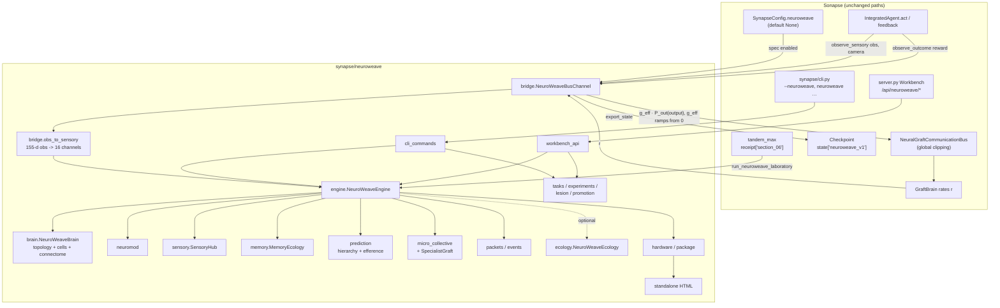

# NEUROWEAVE in Sonapse

NEUROWEAVE is an **opt-in, additive** extension of Sonapse/SYNAPSE that
re-implements the mechanisms of the NEUROWEAVE-LAB 0.4.0 browser prototype in
NumPy (package `synapse/neuroweave/`) and connects them to Sonapse through one
residual graft-bus channel, one checkpoint namespace, one Max Mode section, a
CLI group and a workbench tab.

Nothing changes unless you turn it on. `SynapseConfig().neuroweave` is `None`.
`to_dict()` leaves the key out, so legacy checkpoint schemas are byte-identical.
`NeuroWeaveSpecV1()` is disabled, has gain 0 and enables no mechanisms. Every
receipt carries `evidence_tier: 'synthetic_abstraction'`.

Related documents:
- [INTEGRATION_CONTRACT.md](INTEGRATION_CONTRACT.md): the module contract
- [BASELINE.md](BASELINE.md): the pre-NEUROWEAVE baseline tag and regression record
- [FEATURE_MATRIX.md](FEATURE_MATRIX.md): NEUROWEAVE 0.4.0 compared with Sonapse
- [CHANGELOG.md](CHANGELOG.md): what changed

> **Evidence boundary.** This is a synthetic computational abstraction. It is
> not a validated biological neuron model, not a FlyWire simulation and not an
> FPGA implementation. It is not evidence of emotion, consciousness or general
> intelligence. None of the 24 registered experiments has produced an `improved`
> verdict so far; the supplementary sequence-variant search reports `worse`
> overall and `improved` only for sparse vs random in one synthetic setting (see
> [Research limitations](#12-research-limitations-and-evidence-boundaries)).

---

## 1. Original Sonapse architecture (unchanged)

The pre-NEUROWEAVE system is frozen at git tag
`sonapse-pre-neuroweave-baseline` (commit `6f2761b`). In brief (see the root
[README](../../README.md) for detail):

- **GraftBrain recurrent rate connectome** (`synapse/agent.py`,
  `IntegratedAgent`). Signed recurrent rate dynamics drive the embodied agent.
  It reads a 155-dimensional observation (depth, RGB rays, proprioception, task
  one-hot, cues, reward and time) and returns motor actions.
- **Neural graft communication bus** (`synapse/graft_bus.py`). Residual
  "graft" channels (for example DSAG, the dual-soma axodendritic graft) propose
  bounded currents over the brain's neurons; the bus applies the global
  clipping.
- **Frozen Poseidon Tidal MoE controller**, homeostatic drives,
  neuromodulation, astrocyte reservoir, MiMoMix dual-process reasoner, sleep,
  neurogenesis, fast-weight memory and many standalone research modules under
  `synapse/`.
- **Configuration** (`synapse/config.py`, `SynapseConfig`) with
  `max_tandem(...)` for Max Mode. **Max Mode** lives in `synapse/tandem_max.py`
  (sections 01–05, with a checkpoint in section 05).
- **CLI** (`synapse/cli.py`), **web workbench** (`synapse/server.py` plus
  `synapse/web/`), and checkpoints with fixed namespaces.

## 2. What was added, and where

| Area | Location | Notes |
|---|---|---|
| Shared spec, registries | `synapse/neuroweave/spec.py` | `NeuroWeaveSpecV1`, 45 mechanisms, 24 experiments, 16 sensory channels, 12 topologies, 10 regions |
| Connectome topologies + metrics | `topology.py` | 12 generators; degree-preserving `degree_shuffled` |
| Multi-compartment cells | `cells.py` | 4 dendrites, 8 soma roles, membrane, axon, astrocyte, Q8.8 |
| Synapse table | `connectome.py` | delays, tiling, INT8, routing, reward/STDP/meta plasticity, structural events, lesion copies |
| Brain | `brain.py` | `NeuroWeaveBrain`: topology + cells + synapses + readout; `frozen_step` |
| Neuromodulation and affect | `neuromod.py` | 6 modulators, receptor matrix, 7 affect control variables, transmitter hypotheses |
| Sensory hub | `sensory.py` | 16 channels, 4 modes, reliability fusion, cross-modal imputation, derived camera/audio features |
| Micro-Collective, specialist graft | `micro_collective.py` | top-k MoE sensory predictor with rollback; zero-coupled graft |
| Memory ecology | `memory.py` | provenance-tagged, FlyHash-indexed, multi-timescale memory |
| Prediction | `prediction.py` | horizon hierarchy, ensembles, counterfactuals, efference self-model |
| Packets / events | `packets.py`, `events.py` | typed representation packets, fusion, event bus |
| Ecology | `ecology.py` | 1200×660 arena with 7 configs; Sonapse 155-d observation adapter |
| Hardware / packages | `hardware.py`, `package.py` | INT8/Q8.8, tile schedule, FPGA mapping manifest, `SONAPSE_NEUROWEAVE_PACKAGE`, legacy import |
| Engine | `engine.py` | `NeuroWeaveEngine` composes all subsystems; engine-level `AssociativeTraceMemory` and `FastWeightMemory` (added 2026-11-19) |
| Sonapse bridge | `bridge.py` (the only torch module) | `NeuroWeaveBusChannel`, `obs_to_sensory` |
| Laboratory | `tasks.py`, `experiments.py`, `lesion.py`, `promotion.py` | 24 experiments, lesion assay, promotion ledger |
| Standalone runner | `standalone.py` | offline HTML page with JS frozen inference |
| CLI | `cli_commands.py` plus additions to `synapse/cli.py` | `--neuroweave`, `--neuroweave-config`, `neuroweave …` |
| Workbench | `workbench_api.py` plus additions to `synapse/server.py` and `synapse/web/*` | `/api/neuroweave/*`, "06 NEUROWEAVE Lab" tab |
| Sonapse wiring | `synapse/config.py`, `synapse/agent.py`, `synapse/tandem_max.py` | additive field, channel, checkpoint namespace, Max Mode section 06 |
| Compatibility manifest | `scripts/neuroweave_compat_manifest.py`, `docs/neuroweave/compatibility-manifest.json` | additive-only check |

## 3. Integration relationships

The NEUROWEAVE engine sits beside the brain; it does not replace it. Its only
causal path into Sonapse is the residual current that `NeuroWeaveBusChannel`
proposes to the graft bus:

- **Disabled:** the current is `torch.zeros_like(r)` and the engine never steps.
- **`observe_only`:** the engine steps, but the returned current is exactly zero.
- **Active:** `g_eff · P_out(engine.output)`, where `P_out` is a fixed seeded
  sparse projection. `g_eff` ramps linearly from 0 to `spec.gain` over
  `spec.ramp_steps` and is clipped to `spec.max_gain`.

The engine advances once per brain forward pass (microstep 0).

## 4. Mechanisms (45)

The ids come from `MECHANISM_IDS` in `spec.py`, in their stable order. The
first 31 are NEUROWEAVE 0.4.0's switches; the last 14 are Sonapse-side
extensions.

**Consumed by:** where the flag is read at runtime.
- `cells`: `cells.NEURON_FLAGS`
- `brain`: `brain.BRAIN_FLAGS`
- `connectome`: `brain.CONNECTOME_FLAGS`
- `engine`: `engine.ENGINE_FLAGS`

The union of these sets covers all 45 ids. Until 2026-11-19
`associative_memory` and `fast_weights` were declared in the spec but read by
no runtime code. They are now engine-level mechanisms (rows 4 and 18; rules in
section 6). `memory_ecology` is still a separate store.

**Tests:** abbreviations for the test files.
- `core` = `tests/test_neuroweave_core.py`
- `eng` = `test_neuroweave_engine.py`
- `ms` = `test_neuroweave_modulation_sensory.py`
- `mm` = `test_neuroweave_micro_memory.py`
- `pp` = `test_neuroweave_prediction_packets.py`
- `af` = `test_neuroweave_assoc_fastweights.py`
- `hw` = `test_neuroweave_hardware_package.py`
- `sa` = `test_neuroweave_standalone.py`

Two parametrised tests appear in many rows:
- `core::each_neuron_flag` = `test_each_neuron_flag_changes_cell_output`, run for every `NEURON_FLAGS` entry.
- `core::each_consumed` = `test_each_consumed_mechanism_changes_output`, run for every `CONSUMED_FLAGS` entry except `tiled_execution` and `meta_plasticity`.

Both assert that the output changes when the single flag is switched on.
`sa::js_parity` (`test_js_frozen_step_matches_python`) checks the JS mirror
against Python for the four mechanism sets in that file.

| # | Mechanism id | Origin | Status | Consumed by / module | Test references |
|---|---|---|---|---|---|
| 1 | `multi_soma` | neuroweave | implemented | cells | core::each_neuron_flag, core::each_consumed |
| 2 | `structural_encoder` | neuroweave | implemented | brain | core::each_consumed; sa (embedded weights) |
| 3 | `sparse_code` | neuroweave | implemented | cells, brain | core::each_neuron_flag, `test_q88_and_sparse` |
| 4 | `associative_memory` | neuroweave | implemented (engine-level, since 2026-11-19; not executed by the standalone page) | engine (`AssociativeTraceMemory`) | `af::test_each_flag_alone_changes_outputs_from_the_step_after_the_first_write`, `af::test_associative_recall_picks_best_cosine_match_and_scales_the_stored_state`, `af::test_associative_store_gating_fifo_capacity_and_clipping`, `af::test_engine_step_feeds_exactly_recall_plus_fast_read_into_the_brain` |
| 5 | `reward_plasticity` | neuroweave | implemented | connectome | `core::test_reward_update_bounded_sign_preserving_and_meta`, core::each_consumed |
| 6 | `synaptic_delays` | neuroweave | implemented | connectome | `core::test_delay_ring_buffer`, core::each_consumed |
| 7 | `homeostatic_governor` | neuroweave | implemented | cells | core::each_neuron_flag |
| 8 | `tiled_execution` | neuroweave | implemented (numerically identical by design) | connectome | `core::test_tiled_traversal_matches_untiled`, `core::test_meta_plasticity_and_tiled_execution` |
| 9 | `context_attention` | neuroweave | implemented | brain | `core::test_context_attention_matches_definition`, core::each_consumed |
| 10 | `flyhash_projection` | neuroweave | implemented | brain | `core::test_input_projection_any_length_and_flyhash`, core::each_consumed |
| 11 | `neuromodulator_field` | neuroweave | implemented | engine / neuromod | `eng::test_engine_level_mechanism_changes_outputs`, `ms::test_each_modulator_driver` |
| 12 | `structural_plasticity` | neuroweave | implemented | connectome | `core::test_structural_step_cap_events_and_lesion`, `eng::test_structural_plasticity_and_neurogenesis_stay_within_caps` |
| 13 | `sleep_consolidation` | neuroweave | implemented | brain | `core::test_consolidation_protects_synapses_from_sleep_downscaling`, core::each_consumed |
| 14 | `predictive_ensemble` | neuroweave | implemented (ensemble of 3 when on, 1 when off, so disagreement-based uncertainty exists only with it) | engine / prediction | base mechanism in `eng::test_engine_level_mechanism_changes_outputs[uncertainty_gating]`; `pp::test_forecast_and_update_shapes_and_learning` |
| 15 | `adaptive_conduction` | neuroweave | implemented | connectome | core::each_consumed, `core::test_frozen_step_does_not_change_synaptic_myelin` |
| 16 | `quantised_synapses` | neuroweave | implemented | connectome | `core::test_quantised_int8`, `hw::test_quantise_int8_symmetric_and_bounded` |
| 17 | `axonal_branches` | neuroweave | implemented | cells | core::each_neuron_flag, `core::test_cell_myelin_sets_axonal_release_efficacy` |
| 18 | `fast_weights` | neuroweave | implemented (engine-level, since 2026-11-19; not executed by the standalone page) | engine (`FastWeightMemory`) | `af::test_each_flag_alone_changes_outputs_from_the_step_after_the_first_write`, `af::test_fast_weight_write_and_read_follow_the_rule_exactly`, `af::test_fast_weights_store_reward_signed_value_key_associations`, `af::test_engine_step_feeds_exactly_recall_plus_fast_read_into_the_brain` |
| 19 | `efference_self_model` | neuroweave | implemented | engine / prediction | `eng::test_engine_level_mechanism_changes_outputs`, `pp::test_efference_*` (4 tests) |
| 20 | `predictive_coding` | neuroweave | implemented | cells | core::each_neuron_flag |
| 21 | `stdp` | neuroweave | implemented | connectome | `core::test_stdp_traces_bounded_and_timing_rule`, `core::test_stdp_learns_with_membrane_spikes` |
| 22 | `adaptive_routing` | neuroweave | implemented | connectome | `core::test_routing_uncertainty_and_region_gain`, core::each_consumed |
| 23 | `hierarchical_temporal_memory` | neuroweave | implemented | cells | core::each_neuron_flag |
| 24 | `uncertainty_gating` | neuroweave | implemented | connectome, engine | core::each_consumed, `eng::test_engine_level_mechanism_changes_outputs` |
| 25 | `multimodal_sensory` | neuroweave | implemented | engine / sensory | `eng::test_engine_level_mechanism_changes_outputs`, `test_neuroweave_server.py` |
| 26 | `affective_modulation` | neuroweave | implemented | engine / neuromod | `eng::test_engine_level_mechanism_changes_outputs`, `ms::test_affect_appraisal` |
| 27 | `micro_collective` | neuroweave | implemented | engine / micro_collective | `eng::test_micro_collective_trains_on_consecutive_frames_and_specialist_starts_neutral`, `mm::test_validation_loss_beats_persistence_after_training` |
| 28 | `expert_routing` | neuroweave | implemented | engine / micro_collective | `mm::test_load_balancing_reduces_imbalance`, `mm::test_from_spec_flags_map_to_behaviour` |
| 29 | `meta_plasticity` | neuroweave | implemented | connectome, micro_collective | `core::test_meta_plasticity_and_tiled_execution`, `core::test_reward_update_bounded_sign_preserving_and_meta` |
| 30 | `predictive_replay` | neuroweave | implemented | engine / micro_collective, memory | `eng::test_memory_provenance_and_predictive_replay`, `mm::test_novelty_prioritised_sampling` |
| 31 | `transmitter_inference` | neuroweave | implemented (analysis only; never changes the forward pass) | engine observatory / neuromod | `ms::test_infer_transmitters_never_modifies_sign`, `ms::test_infer_transmitters_structure_sensitive` |
| 32 | `dendritic_compartments` | sonapse_extension | implemented | cells | core::each_neuron_flag, `core::test_dendritic_apical_gates_basal_and_axon_myelin` |
| 33 | `extended_somas` | sonapse_extension | implemented | cells | core::each_neuron_flag, `core::test_extended_somas_primary_secondary_burst_gating` |
| 34 | `membrane_dynamics` | sonapse_extension | implemented | cells | `core::test_membrane_dynamics_spikes_refractory_and_calcium` |
| 35 | `astrocyte_regulation` | sonapse_extension | implemented | cells | core::each_neuron_flag |
| 36 | `receptor_heterogeneity` | sonapse_extension | implemented (with `neuromodulator_field`: per-unit receptor-weighted gain on the external drive) | engine / neuromod, brain | `ms::test_receptor_heterogeneity_matrix`, `ms::test_per_unit_gain_heterogeneity_and_traces`, `test_neuroweave_review_fixes.py::test_receptor_heterogeneity_changes_engine_dynamics_with_neuromodulation` |
| 37 | `multi_region_routing` | sonapse_extension | implemented | connectome, engine | `eng::test_multi_region_routing_uses_modulated_route_gains`, core::each_consumed |
| 38 | `neurogenesis` | sonapse_extension | implemented | brain | `core::test_growth_caps_and_ledger`, core::each_consumed |
| 39 | `memory_ecology` | sonapse_extension | implemented | engine / memory | `eng::test_engine_level_mechanism_changes_outputs`, `mm` memory-ecology tests (24) |
| 40 | `hierarchical_prediction` | sonapse_extension | implemented | engine / prediction | module-level: `pp::test_adaptive_horizon_shortens_after_regime_shift`, `pp::test_longer_horizon_less_accurate` |
| 41 | `counterfactual_prediction` | sonapse_extension | implemented | engine / prediction | module-level: `pp::test_counterfactual_is_pure_and_action_sensitive` |
| 42 | `cross_modal_memory` | sonapse_extension | implemented | engine / sensory | `ms::test_cross_modal_imputation_only_with_flag` |
| 43 | `specialist_graft` | sonapse_extension | implemented (coupling starts at 0) | engine / micro_collective | `mm::test_graft_*` (6 tests), `test_neuroweave_lab.py::test_graft_removal_restores_exact_uncoupled_outputs` |
| 44 | `representation_fusion` | sonapse_extension | implemented | engine / packets | `eng::test_engine_level_mechanism_changes_outputs`, `pp::test_fusion_*` (5 tests) |
| 45 | `q88_state` | sonapse_extension | implemented | cells | core::each_neuron_flag, `hw::test_q88_roundtrip_and_saturation` |

Several engine flags are tested at module level, not through an engine on/off
comparison:
- `hierarchical_prediction`
- `counterfactual_prediction`
- `transmitter_inference`
- `expert_routing`
- `predictive_replay`

All 45 flags are switched on together in several tests:
- `core::test_dale_and_finite_after_200_steps_all_mechanisms`
- `eng::test_determinism_and_export_import_round_trip`
- the integration and standalone tests

## 5. Sensory systems and privacy

**Channels.** 16 channels, in the fixed order of `SENSORY_CHANNELS`:

| Group | Channels |
|---|---|
| Visual | luminance, red/green, blue/yellow, edge density, motion |
| Auditory | low, mid, high |
| Chemical | olfactory, gustatory |
| Somatic | thermal, interoception, proprioception, mechanosensation |
| Context | environment state, task context |

**Modes.** Each channel is in one of four modes: `disabled`, `simulated`
(default), `external` or `live`.

**Fusion.** `SensoryHub.fuse` combines channels weighted by reliability.
Reliability falls with residual variance and with staleness. A missing channel
is predicted from a cross-modal memory only when `cross_modal_memory` is on,
and is then flagged with provenance `predicted`.

**Inside Sonapse.** `bridge.obs_to_sensory` derives the channels from the
155-d observation.
- `audio_low`, `audio_high` and `thermal` have no Sonapse source. They are
  passed as `None` (missing).
- `audio_mid` is a proxy built from agent speed, not real audio.
- A camera frame given to `act()` is reduced to derived scalars.

**Privacy rules.** These are enforced in code and tested:
- `visual_features` and `audio_features` return only scalar features. Frames
  and buffers are never stored. Only a down-sampled luminance map is kept
  privately for motion, and it is never exported (`ms::test_no_raw_media_retained`).
- Every sensory manifest, telemetry and package reports
  `raw_media_stored: False`.
- Package validation rejects raw-media keys and `data:image|audio|video` URIs
  (`hw::test_raw_media_detection_is_precise`).
- The workbench `/api/neuroweave/sensory` endpoint accepts only scalar values.
  It rejects:
  - bodies over 64 KB
  - arrays longer than 64
  - raw-media keys (`frame`, `samples`, `pcm`, `image`, …)
  - `data:` strings and long strings
  - non-finite values and booleans
- **Webcam and microphone in the workbench tab.** Capture runs in the browser.
  Only derived scalars are posted:
  - webcam: luminance, colour opponency, edge density, motion
  - microphone: amplitude and low/mid/high band energies

  This browser path has **not** been exercised with a real camera or microphone
  in testing; only the code path and the server-side rejection rules are
  tested.
- The standalone HTML page never requests camera or microphone access.

## 6. Learning mechanisms

All plasticity is bounded and keeps each synapse's sign (Dale-style); the
source sign is never flipped. Rows marked *(core)* are covered by
`core::test_dale_and_finite_after_200_steps_all_mechanisms`.

| Mechanism | Rule |
|---|---|
| Reward-gated plasticity | Eligibility traces × reward × learning rate, with bounded magnitude. |
| Pair-based STDP | Pre/post spike traces with a timing rule; traces bounded. |
| Meta-plasticity | Per-synapse learning-rate scale adapted from update history. |
| Structural plasticity and neurogenesis | Utility-guided prune/grow/rewire and capped neuron birth. Caps are `max_synapses` and `max_neurons`. Every event goes to a bounded ledger as `{step, kind, src, dst, reason, utility}`. |
| Sleep-like consolidation | Every `sleep_interval` steps: replay, trace consolidation and synaptic downscaling. Consolidated synapses are protected from downscaling. |
| Readout | Online logistic readout trained by the brain; `frozen_step` disables all learning. |
| Micro-Collective | Self-supervised next-sensor prediction with top-k routing, novelty-prioritised replay and a held-out validation split. Keeps a best-state snapshot and rolls back when validation worsens. SHA-256 training receipts. |
| Specialist graft | A separate small recurrent predictor trained only through its own interface. Its coupling starts at 0. `detach()` removes it without residue. |
| Representation fusion | Configured or delta-rule learned fusion weights. With zero weights or no packets the input passes through unchanged. |
| Memory ecology | Store, retrieve, confirm, replay, forgetting and downscaling. `PREDICTED` items are never returned as verified and are promoted only by `confirm()`. |
| Associative trace memory (`associative_memory`; engine, not synaptic) | **Key:** the first 32 values of the step's external drive, zero-padded and clipped to [−1, 1], taken before any attached extension. The external drive is the composed 40-value drive, or the task input when none of `multimodal_sensory`, `memory_ecology` or `representation_fusion` is on. **Store** (learning steps only): when the raw reward, clipped to [−1, 1], exceeds 0.35 and the step index is a multiple of 12, append `(key, unit outputs)`. The store is a FIFO of at most 32 episodes. **Recall** (every step, including frozen steps): take the episode with the highest cosine similarity `k·q / (‖k‖‖q‖ + 1e-9)`, the earliest on ties. If that similarity exceeds 0.35, unit *i* receives `0.11·sim·state_i`, with the state zero-padded or truncated to the current population. An empty store or a weak match adds nothing. Keys and states are clipped, so one recall adds at most 0.11 per unit. |
| Universal fast weights (`fast_weights`; engine, not synaptic) | **Key `k`:** the first 8 drive values, clipped. **Read** (every step, including frozen steps): `f = M k`, and unit *i* receives `0.03·f[i mod 8]`, at most 0.24 in magnitude. **Write** (learning steps whose raw reward `R`, clipped to [−1, 1], is non-zero): `M ← clip(0.999·M + 0.0012·\|R\|·R·v kᵀ, −1, 1)`. Here `v` is the first 8 pooled readout features after the step, clipped. A zero matrix adds nothing. |
| Neuromodulation controls | `learning_rate_scale`, `plasticity_scale`, `attention`, `threshold_shift`, `gain`, `sensory_weight`, … are consumed by the engine. `controls['applied_to_brain']` is reported per step. |

**Associative trace memory and fast weights (engine-level, added 2026-11-19).**
These are `AssociativeTraceMemory` and `FastWeightMemory` in `engine.py`. The
recall and the fast-weight read are summed into one per-unit input,
`NeuroWeaveBrain.step(unit_input=...)`. That input is added to the
feed-forward drive after any receptor gain.

Behaviour and tests (all in `af`):
- **Exact no-op when off.** Without either flag the engine never passes
  `unit_input`, and states and observatories gain no new keys
  (`test_neither_flag_keeps_the_previous_code_path`). With the flags on but
  nothing written yet, outputs are bit-identical to the engine without them
  (`test_empty_store_and_zero_matrix_contribute_exactly_nothing`).
- **Learning only with `learn=True`.** Only learning steps store or write.
  Frozen steps still read what was learned
  (`test_frozen_steps_read_but_never_write`).
- **Known-answer tests** for both rules:
  `test_associative_recall_picks_best_cosine_match_and_scales_the_stored_state`,
  `test_associative_store_gating_fifo_capacity_and_clipping`,
  `test_fast_weight_write_and_read_follow_the_rule_exactly`,
  `test_fast_weights_store_reward_signed_value_key_associations` and
  `test_engine_step_feeds_exactly_recall_plus_fast_read_into_the_brain`.
- **Bounds and determinism.** Contributions and stored state stay bounded under
  hostile inputs (`test_contributions_and_state_stay_bounded`). Same seed gives
  the same outputs and state digest, a JSON round trip continues exactly, and
  the global NumPy RNG is untouched
  (`test_determinism_round_trip_and_no_global_rng_use`).
- **Persistence.** The state is in `export_state()['associative_memory']` and
  `['fast_weights']`, present only when the flag is on. `import_state`
  validates both before it swaps anything in
  (`test_import_validates_everything_before_mutating`). Besides shapes and
  bounds it checks what the rules imply: episode steps are increasing
  multiples of 12 below the engine step, exactly `min(stores, 32)` episodes
  remain, there is at most one recall hit and one fast-weight write per step,
  `stores` does not exceed the number of scheduled store steps, and a non-zero
  matrix has at least one recorded write
  (`test_from_state_enforces_capacity_and_per_step_counts`). A state saved
  without these keys imports with an empty store and a zero matrix
  (`test_states_saved_before_the_mechanisms_existed_import_with_fresh_memories`).
- **Step results.** `step()` reports per-step `associative_memory` and
  `fast_weights` records, and `observatory()['learning']` reports their
  summaries.

**Where the constants come from.** They follow the NEUROWEAVE-LAB 0.4.0
`memory` and `fastWeights` switches as re-implemented in the sibling
SONAPSE-EVO port (`src/sonapse_evo/neuroweave/memory/associative.py` and
`memory/fast_weights.py`, read at commit `eb498fb`). All eleven constants
match that port. The original JavaScript was not available to this build. This
version differs from that port in four ways:
- keys are taken from the engine's external drive, not the port's observation
  vector;
- keys, stored states and fast-weight values are clipped to [−1, 1];
- the stored state is the unit-output vector, not the port's rate vector;
- the fast-weight value is the first 8 of this engine's pooled readout
  features (`NeuroWeaveBrain.readout_features`), not the port's
  `pooled_features`.

**Related work (inspired by, not reproductions).**
- The fast weights are a hetero-associative, reward-signed variant of the
  decaying outer-product fast weights of Ba et al. (2016),
  `A(t) = λA(t−1) + η h(t)h(t)ᵀ`.
- The recall resembles the key-similarity lookup of Neural Episodic Control
  (Pritzel et al., 2017). It uses a single best cosine match, not that paper's
  kernel-weighted sum over the p nearest neighbours.
- Both writes are reward-gated, in the spirit of three-factor learning rules
  (Frémaux & Gerstner, 2016).

References (titles, authors, venues and the two rules quoted above checked
against the publisher and arXiv pages on 2026-11-20):
- J. Ba, G. E. Hinton, V. Mnih, J. Z. Leibo, C. Ionescu, "Using Fast Weights to
  Attend to the Recent Past", *Advances in Neural Information Processing
  Systems 29* (NIPS 2016), Dec 2016.
  <https://proceedings.neurips.cc/paper/2016/hash/9f44e956e3a2b7b5598c625fcc802c36-Abstract.html>
  (arXiv:1610.06258; its rule, Eq. 1, is Hebbian and not reward-gated)
- A. Pritzel, B. Uria, S. Srinivasan, A. Puigdomènech Badia, O. Vinyals,
  D. Hassabis, D. Wierstra, C. Blundell, "Neural Episodic Control", *Proc.
  34th ICML*, PMLR 70:2827–2836, Aug 2017.
  <https://proceedings.mlr.press/v70/pritzel17a.html> (arXiv:1703.01988; its
  lookup uses p = 50 neighbours and an inverse-squared-distance kernel)
- N. Frémaux, W. Gerstner, "Neuromodulated Spike-Timing-Dependent Plasticity,
  and Theory of Three-Factor Learning Rules", *Frontiers in Neural Circuits* 9,
  published 19 Jan 2016. <https://doi.org/10.3389/fncir.2015.00085>

## 7. Experiments (24) and methodology

`spec.EXPERIMENTS` lists 24 experiments in six kinds. Each experiment's
mechanism set is listed in `spec.py`.

| Kind | Experiments |
|---|---|
| `temporal_task` (17) | multimodal_integration, affective_neuromodulation, meta_plasticity, predictive_replay, context_attention, flyhash_projection, stdp, adaptive_conduction, quantised_synapses, hierarchical_temporal_memory, uncertainty_gating, predictive_coding, structural_plasticity, associative_memory, multi_soma_integration, multi_region_routing, cross_modal_learning |
| `micro` (3) | micro_collective_learning, expert_routing, specialist_evolution |
| `ecology` (1) | action_self_model |
| `lesion` (1) | lesion_robustness |
| `topology` (1) | topology_optimisation |
| `graft` (1) | neural_grafting |

**Supplementary experiment (not one of the 24).** `sequence_search`
(`sequence_search.py`, run through `experiments.run_supplementary_experiment`)
is a Fly-Protein-inspired, budget-matched synthetic sequence-variant search.
Sparse random-projection guidance (k-winners code, overlap-weighted fitness
estimate scores 24 mutants per query), steady-state evolutionary search and
random search each get exactly `budget` fitness queries per run (default 50) on
the same landscapes (default 10 landscapes × 8 seeds, length 24, alphabet 20).
The landscape is a synthetic additive-plus-pairwise-epistatic function. The
top-1% hit threshold is the empirical 99th percentile of 600 random reference
sequences per landscape (not counted in the budget). Verdicts use paired 95% t
intervals over (landscape, seed) runs. Runs on one landscape share it, so the
interval may be optimistic. It is not protein modelling.

One run at the defaults (single machine, NumPy streams):

| Strategy | Mean best fitness | Top-1% hit rate |
|---|---|---|
| Sparse-code guided | 0.141 | 60.0% |
| Evolutionary | 0.190 | 88.8% |
| Random | 0.117 | 35.0% |

Sparse vs evolutionary: Δ −0.049, 95% CI [−0.064, −0.034] (`worse`). Sparse vs
random: Δ +0.024, 95% CI [+0.013, +0.036] (`improved`). This is one synthetic
setting and does not generalise.

**Methodology** (`experiments.py`, `tasks.py`, `lesion.py`):

**Tasks** (`tasks.TASKS`), seeded streams:
- `delayed_recall` (2 steps back) and `delayed_recall_6` (6 steps back)
- `xor` and `parity`, which need recurrent memory: earlier bits are not copied into the input
- `rhythm`
- `context_switch`, where the context is cued only at the start of each block

**Arms:**
- **Baseline:** no mechanisms, except shared, never-ablated *support mechanisms*:
  - `multimodal_sensory` for ecology
  - `multimodal_sensory` and `micro_collective` for graft
  - per experiment (`EXPERIMENT_SUPPORT`), the consumer a named mechanism needs to act at all:
    `memory_ecology` + `neuromodulator_field` for predictive_replay, `neuromodulator_field` for
    predictive_coding, `reward_plasticity` + `neuromodulator_field` for action_self_model
- **Candidate:** the experiment's mechanisms.
- **Ablations:** one per mechanism (the candidate minus that mechanism). When a minus arm reproduces the
  candidate's train and held-out metrics bit-for-bit, the mechanism is reported as
  `inert_in_this_configuration` (listed in `inert_mechanisms`) instead of an ablation verdict.
- **Micro kind:** also compared against persistence and a parameter-matched dense MLP.

**Metrics:**
- Prequential (predict, then learn): accuracy, log-loss and Brier score on the training stream.
- **Frozen evaluation** (`learn=False` on a clone) on held-out seed streams that were never trained on.

**Verdict:**
- Paired per-seed differences give a two-sided 95% t-interval on the held-out metric.
- The verdict is `improved`, `no_detectable_difference` or `worse`, decided **only** by whether that interval excludes 0. A single seed gives `no_detectable_difference`, and so does a zero-variance interval (identical paired differences: reason `degenerate_ci`).
- `topology_optimisation` picks the best of 11 topologies on the same held-out data, so its comparisons use a Bonferroni-adjusted (family of 11) paired t-interval (`ci95_family_adjusted`).
- An `improved` result is downgraded when a guard metric is significantly worse.
- Parameter counts and budget matching are reported but never feed the verdict.

**Receipts:**
- Sealed with SHA-256 over the receipt with wall-clock keys removed, so a rerun with the same arguments gives the same digest.
- `verify_receipt` re-checks the seal.
- Schema `NeuroWeaveLabReceiptV1`; `evidence_tier` is always `synthetic_abstraction`.

**Lesion assay:**
- Lesion kinds: intact, random, hub, region, sensory_pathway, memory_pathway, cross_region.
- Fractions 0.1/0.2/0.3, optionally progressive.
- Lesions are applied to **clones only**. The assay raises an error if the original's state digest or readout weights change.

**Promotion ledger** (`promotion.PromotionLedger`):
- A candidate is promoted only if every receipt:
  - verifies its seal
  - is tier `synthetic_abstraction`
  - has verdict `improved` with a held-out interval that excludes 0
  - tests only mechanisms in the candidate set
- The compatibility tests must also have passed.
- Writes are atomic (temp file, `fsync`, `os.replace`). Failed and rolled-back candidates are archived, never deleted.
- Promotion only changes the ledger's own preset. It never touches Sonapse defaults.

**Results so far:**
- `test_neuroweave_lab.py` checks that every one of the 24 experiments runs at tiny settings (12 steps, 16 neurons) and returns a valid sealed receipt; it does not assert particular verdicts.
- One run of `run_all_experiments(quick=True)` (`QUICK_ARGS`: seeds 0–1, held-out seed 100, 24 steps, 24 neurons) on 2026-11-16 took 36.4 s on one CPU thread (Windows 11 on ARM64, Python 3.12.10, NumPy 2.4.3). All 24 verdicts were `no_detectable_difference`, as expected at that size.
- The full-size defaults (3 seeds × 300 steps, 200-step lesion assay) have **not been run**.
- None of the 24 registered experiments has produced `improved`. The supplementary `sequence_search` assay above reports `worse` overall (sparse vs evolutionary) and `improved` only for sparse vs random in one synthetic setting. The `improved` receipt in the promotion test is a labelled test fixture, not a result.

## 8. Configuration

### `NeuroWeaveSpecV1` (frozen dataclass; `from_dict` rejects unknown fields)

| Field | Default | Valid range / meaning |
|---|---|---|
| `enabled` | `False` | master switch |
| `observe_only` | `False` | engine steps, current exactly 0 |
| `gain` | `0.0` | `[0, 1]`, `≤ max_gain`; residual current gain |
| `max_gain` | `0.1` | `[0, 1]` clip |
| `ramp_steps` | `32` | linear ramp of the effective gain from 0 |
| `seed` | `7` | `[0, 2³¹−1]` |
| `neurons` | `48` | `[8, 4096]` |
| `topology` | `'clustered'` | one of 12 `TOPOLOGIES` |
| `sparsity` | `0.15` | k-WTA active fraction `[0.01, 1]` |
| `tile_size` | `16` | `[1, 4096]` |
| `fan_in` | `6` | `[1, 64]` |
| `inhibitory_fraction` | `0.2` | `[0, 0.9]` |
| `max_neurons` | `512` | neurogenesis cap, `≥ neurons`, `≤ 4096` |
| `max_synapses` | `8192` | structural cap `[16, 250000]` |
| `structural_interval` | `25` | steps between structural updates |
| `sleep_interval` | `100` | steps between consolidation passes |
| `micro_experts` / `micro_top_k` | `4` / `2` | `top_k ≤ experts` |
| `ecology` | `'default'` | ecology config name |
| `mechanisms` | `()` | any subset of the 45 ids (canonicalised order) |
| `sensory_modes` | `()` | `(channel, mode)` pairs; absent channels are `simulated` |

**Helpers:**
- `NeuroWeaveSpecV1.all_mechanisms(**kw)`
- `NeuroWeaveSpecV1.max_preset(seed, neurons)`
- `with_mechanisms`, `to_dict` / `from_dict`
- `spec_digest` (SHA-256)

### Sonapse configuration

- `SynapseConfig.neuroweave: object | None = None`. A dict is coerced to
  `NeuroWeaveSpecV1`; anything else raises `ValueError`. It is left out of
  `to_dict()` when `None`.
- The feature audit lists `neuroweave_v1` and `neuroweave_v1.<mechanism>`
  entries. These are "disabled" when the field is `None` or disabled.

### CLI

**Global flags** (for `run`, `train`, `serve`):
- `--neuroweave` sets an enabled spec with all mechanisms, `gain=0.02` and
  `max_gain=0.1`, seeded from `--seed`.
- `--no-neuroweave` and no flag at all both leave the field `None`.
- `--neuroweave-config <json>` loads an explicit `NeuroWeaveSpecV1`. Using it
  together with `--no-neuroweave` is an error (exit 2).

**`python -m synapse neuroweave <action>`** prints JSON to stdout:

| Action | Options |
|---|---|
| `mechanisms`, `experiments`, `manifest-check` | none |
| `validate` | `--config` |
| `smoke` | `--steps --seed --neurons --topology --mechanisms`; includes an exact checkpoint-replay check |
| `topology` | `--neurons --seeds` |
| `experiment <id\|all>` | `--seeds --steps --quick --csv` |
| `lesion` | `--quick --seeds --steps --neurons` |
| `sequence-search` | `--quick --landscapes --seeds-per-landscape --budget` (supplementary; synthetic, not protein modelling) |
| `ecology` | `--config --frozen --synapse-agent --agent-nodes` plus model options |
| `export` | `--out --html --fpga` plus model options |
| `inspect <file>` | read-only |
| `import-legacy <file>` | `--out` |

`--mechanisms` takes `all`, `none` or a comma list.

### Max Mode preset

`SynapseConfig.max_tandem(...)` adds
`neuroweave=NeuroWeaveSpecV1.max_preset(seed=seed, neurons=min(256, max(48, total_neurons // 32)))`.

The preset:
- turns every mechanism on. Since 2026-11-19 this includes the engine-level
  `associative_memory` and `fast_weights` (section 6). They can act only after
  a learning step has written to them: any non-zero reward writes the fast
  weights, and a reward above 0.35 on a step that is a multiple of 12 stores
  an episode. Runs made after that date can therefore differ from earlier
  ones. The preset also turns on `q88_state`, whose rounding can absorb the
  small fast-weight read (section 12). The difference has not been measured in
  a Max Mode run.
- sets `gain=0.02`, `max_gain=0.1`, `ramp_steps=32`
- uses topology `dense_multi_region`
- sets `max_neurons = min(4096, 2·neurons)` and `max_synapses = min(250000, max(8192, 48·neurons))`

Max Mode runs `run_neuroweave_laboratory` as `receipt['section_06']` before the
section-05 checkpoint, with option `neuroweave_steps` (default 16, range
1–256). `sections_completed` is unchanged.

Further bounded Max Mode options (validated before the live runtime is replaced):

| Option | Range / default | Section 06 key |
|---|---|---|
| `neuroweave_experiments` | 0–1 / 0 (opt-in; 36 s in the one measured run below) | `experiments`: all 24 experiments in quick mode; per-experiment verdict, basis metric, receipt digest and digest check; `receipts_digest` over all digests |
| `neuroweave_lesion` | 0–1 / 0 (opt-in) | `lesion_assay`: quick lesion assay (clones only) verdict, summary and digest |
| `neuroweave_agent_steps` | 0–64 / 4 | `live_agent_ecology`: a deep copy of the live Max Mode agent driven (`learn=False`) in a default `NeuroWeaveEcology`; reward, food, collisions; `live_channel_digest_unchanged` |

`live_channel` always reports the live agent's NEUROWEAVE channel telemetry and
an observatory summary (read-only). The agent copy is skipped, with a reason,
when free memory is below twice the agent's tensor bytes plus a reserve.
Quick experiments use 2 seeds and short streams, so their verdicts are
low-power smoke results, not conclusions. One run of all 24 in quick mode on
2026-11-16 took 36.4 s on one CPU thread (Windows 11 on ARM64, Python 3.12.10,
NumPy 2.4.3).

### Workbench

Tab "06 NEUROWEAVE Lab" (`<section id="neuroweave">`; all new ids are `nwl-*`).

**GET** `/api/neuroweave/…`:
- `catalog`, `status`
- `observatory[/lab]`, `ledger[/lab]`
- `ecology`

**POST** `/api/neuroweave/…`:
- `configure`, `step`, `ecology`, `sensory`
- `experiment`, `topology`, `lesion`
- `export`, `inspect`

The lab endpoints change only a separate lab engine. The live agent's engine
is observed read-only.

## 9. Model export formats

### `SONAPSE_NEUROWEAVE_PACKAGE` 1.0.0 (`package.py`)

- **Contents:** the brain state (`NeuroWeaveBrainStateV1`) plus optional
  components: `neuromod`, `sensory`, `micro_collective`, `memory`,
  `prediction`, `agent`, `environment`, `training_history`, `experiments`.
- **Fingerprint:** SHA-256 over canonical JSON.
- **Validation limits:** 25 MB size, JSON depth 64, neuron and synapse limits,
  finite values, endpoints and signs, and raw-media rejection.
- **`inspect_package(text)`** is read-only. It checks the size before parsing
  and reports problems instead of raising.
- **Capability matrix:** six capabilities, each marked `supported`,
  `requires_runtime` or `unsupported`:
  - `frozen_inference`
  - `continued_learning`
  - `full_simulation`
  - `live_sensory_operation`
  - `exported_memory`
  - `persistent_model_state`

### Standalone HTML runner (`standalone.py`)

`standalone_html(package)` returns one offline page:
- no external URLs
- a CSP meta tag
- no camera or microphone access
- the model embedded through `script_safe_json`

The embedded JS engine mirrors `NeuroWeaveBrain.frozen_step` plus the readout
and the Micro-Collective prediction.

| Runtime capability | Status in page |
|---|---|
| frozen_inference | **supported**. `test_neuroweave_standalone.py` enforces JS vs Python max \|Δ\| ≤ 1e-9 over 12 steps (outputs, readout probability and Micro-Collective prediction; skipped without node). One run on 2026-11-16 with node v24.13.1 observed: all-off 6.1e-16, rich 1.7e-16, hardware 1.9e-16, everything 1.7e-16 |
| continued_learning | not available (plasticity runs only in NumPy) |
| live_sensory_operation | not available (channels are typed in) |
| full_simulation | not available (no ecology, neuromodulation, prediction hierarchy or memory ecology) |
| exported_memory | not available |
| persistent_model_state | not available (in-memory; Reset restores the embedded state) |

Per mechanism, `standalone_capabilities` sorts every enabled mechanism into
one of three lists:
- **executed**
- **partial:**
  - `multi_region_routing` uses the stored route matrix only
  - `uncertainty_gating` has its gate fixed at 1.0
- **not executed:**
  - the learning-only mechanisms
  - the engine-level subsystems
  - `associative_memory` and `fast_weights`: their episode store and 8×8
    matrix are engine state (`NeuroWeaveEngine.export_state`), which the
    package does not carry, so the page runs neither read

**Abstain / review outcome (heuristic, not calibrated).** Each step also
reports `selective`: `margin = |2p−1|`, `risk = clip(router_entropy, 0, 1)`
(0 when the package has no Micro-Collective), `score = margin·(1−risk)`. The page
shows `ABSTAIN · REVIEW` when `score < threshold`. The threshold is a page
control (default 0.12 when `uncertainty_gating` is enabled, as in NEUROWEAVE-LAB
0.4.0, else 0 = never abstain). The raw readout probability is always shown and
never altered. The score is not a calibrated confidence. `frozen_reference`
returns the same record, and the node parity test checks score, margin, risk and
decision at thresholds 0, 0.5 and 0.97.

The page feeds the 24-value `[task | sensory]` vector straight to the brain
with neutral controls. It does **not** reproduce the engine's 40-value
composed drive. The page has not been opened in a real browser in testing;
parity was checked by running the embedded script in node.

### FPGA mapping manifest (`hardware.py`)

Format `SONAPSE_NEUROWEAVE_FPGA_MAPPING` 1.0.0:
- signed INT8 synapses (127 levels)
- Q8.8 neuron-state hints
- tile schedule
- pipeline stages: `load_weights`, `stream_activations`, `accumulate`, `writeback`
- endpoint and sign validation

Every manifest records `rtl_generated: False` and `hardware_validated: False`
and carries the disclaimer: no RTL, testbench, synthesis or bitstream; cycle
and resource figures are analytic estimates. `engine.fpga_manifest()` adds an
`independent_validation` block.

### Legacy NEUROWEAVE import

`NEUROWEAVE_MODEL_PACKAGE` 1.0.0, 1.1.0 and 1.2.0 (the JS prototype's format)
can be validated and converted. Import is read-only:
- **Fingerprint:** FNV-1a checked with a JS-compatible `JSON.stringify` reimplementation.
- **Feature mapping:** the 31 legacy feature ids map one-to-one to the first 31 mechanism ids.
- **Provenance:** tagged `imported_neuroweave_js`.
- **Tests:** `hw::test_legacy_*`, `hw::test_fnv1a_matches_javascript` (node).

## 10. Compatibility guarantees

**Baseline.** Git tag `sonapse-pre-neuroweave-baseline` points to commit
`6f2761b`. The baseline regression record is in [BASELINE.md](BASELINE.md).

**Compatibility manifest.** `python scripts/neuroweave_compat_manifest.py
--check` verifies that every recorded public surface is still present:
- 99 config defaults
- 68 CLI sub-commands
- 65 CLI flags
- 138 HTTP routes
- 325 workbench DOM ids
- 45 checkpoint namespaces
- 123 test modules
- 71 Max Mode features

New surfaces are allowed; removals and changed defaults fail the check.
`test_neuroweave_integration.py::test_compatibility_manifest_has_no_problems`
runs the same check.

**All-off identity:**
- `core::test_all_off_identity_and_baseline_equivalence`: an all-off brain
  equals the v0.1 baseline update to `1e-12`.
- `eng::test_all_off_engine_equals_bare_brain`: an all-off engine's output
  equals the bare brain's exactly (`np.array_equal`). The test also checks
  that `controls['applied_to_brain']` and `sensory['fed_to_brain']` are
  `False`.

**Scalar pathway equivalence.**
`test_neuroweave_integration.py::test_scalar_pathway_bit_identical_when_neuroweave_is_neutral`
checks that Sonapse rates and actions are **bit-identical** across:
- `neuroweave=None`
- a disabled spec
- an enabled spec with gain 0
- `observe_only`

`test_positive_gain_changes_rates` checks that gain above 0 does change them.

**Checkpoints.** NEUROWEAVE state lives only in `state['neuroweave_v1']`
(`NeuroWeaveCheckpointV1`, SHA-256 digest, spec digest and host-dimension
checks).
- A legacy checkpoint loads into a NEUROWEAVE-enabled agent.
- A NEUROWEAVE checkpoint is rejected by an agent configured without it.
- A NEUROWEAVE-enabled checkpoint that is missing its namespace is rejected.
- Replay after load is exact.

Tests: `test_checkpoint_round_trip_and_legacy_rules`,
`test_config_defaults_round_trip_and_matches_saved`.

**Determinism.** Every random draw uses seeded `numpy.random.default_rng`.
Wall-clock appears only in `*wallclock*` / `latency_ms` fields, which are left
out of digests and checkpoints.

## 11. Performance

**Measured** on 2026-11-15 on this development machine: Windows 11 on ARM,
Qualcomm 8-core ARMv8 CPU, Python 3.12.10, NumPy 2.4.3, BLAS threads limited
to 1 (`OPENBLAS_NUM_THREADS=OMP_NUM_THREADS=MKL_NUM_THREADS=1`).

**Method:**
- Topology `clustered`, seed 1, `max_neurons = neurons` (no growth).
- 5 warm-up steps, then the median of 60 timed steps for the brain (40 for the engine).
- Repeated on 3 fresh instances; the table shows the min–max of the three medians.
- Brain input: an 8-vector. Engine input: an 8-vector task input plus a 16-vector sensory input.

| Population | Edges | `NeuroWeaveBrain.step` all-off | all 45 on | `NeuroWeaveEngine.step` all-off | all 45 on |
|---|---|---|---|---|---|
| 48 | 276 | 1.06–1.32 ms | 2.70–3.52 ms | 2.41–2.89 ms | 13.2–15.5 ms |
| 128 | 757 | 1.30–1.73 ms | 3.83–4.44 ms | 3.12–3.57 ms | 11.8–14.7 ms |
| 512 | 3070 | 1.69–1.96 ms | 7.11–9.36 ms | 3.76–4.30 ms | 18.9–21.5 ms |

**Caveats:**
- These are single-machine, single-thread wall-clock numbers taken while the
  machine was low on RAM and disk. They are not a benchmark.
- The engine all-on time at n=48 is not lower than at n=128. A likely reason,
  not profiled, is that the fixed-size subsystems (Micro-Collective,
  prediction ensembles, memory) dominate the cost at small n.
- The core of Max Mode section 06 (`run_neuroweave_laboratory` at the max
  preset, 256 neurons, 16 steps, no opt-in extras) took 2.6–2.8 s over three
  runs on 2026-11-16, on one CPU thread on the same machine.
- These timings predate the engine-level `associative_memory` and
  `fast_weights` (added 2026-11-19). In the "all 45 on" columns those two did
  no work then. Per step they now add a cosine search over at most 32 stored
  keys of 32 values, an 8×8 read and write, and one per-unit vector addition.
  The table has not been re-measured.

**Estimates (not measurements):**
- The brain's own profile estimates state memory as `synapses·40 + n·224`
  bytes, about 0.24 MB at n=512 with 3070 edges.
- FPGA cycle and resource figures in the mapping manifest are analytic
  estimates only.

## 12. Research limitations and evidence boundaries

- **No biological validation.** The neurons, dendrites, astrocytes, myelin,
  transmitters and regions are named after biology. The update equations are
  simplified abstractions and have not been fitted to or validated against
  biological data. Transmitter inference is a connectivity-only hypothesis
  and never relabels a source sign.
- **Affect variables are control signals, not emotions.** Valence, arousal,
  curiosity, stress, motivation, novelty and reward-prediction error are
  bounded scalars that scale gain, plasticity, attention and exploration.
  They are not subjective states.
- **No FPGA RTL.** The FPGA output is a mapping manifest. No RTL, simulation,
  synthesis, bitstream or hardware execution exists. Cycle and resource
  numbers are estimates.
- **No demonstrated benefit yet.** Every verdict so far for the 24 registered
  experiments (quick mode only) is `no_detectable_difference`, and the
  full-size experiments have not been run. The supplementary sequence-variant
  search reports `worse` overall and `improved` only for sparse vs random in
  one synthetic setting. Complexity is not evidence of improvement.
- **`associative_memory` and `fast_weights` are new and show no benefit
  yet.** Before 2026-11-19 they were declared but not implemented. They are now
  engine-level mechanisms (section 6). Quick-mode receipts were re-run on
  2026-11-20 with `QUICK_ARGS`: seeds 0 and 1, held-out seed 100, 24 training
  and 12 held-out steps, 24 neurons, one CPU thread. Each was run twice and
  gave the same receipt digest both times. Other jobs were running on the
  machine, so the wall-clock times are only indicative. Results:
  - `associative_memory`: `no_detectable_difference` with reason
    `degenerate_ci`; the held-out accuracy difference was 0 on both seeds. All
    three ablations (`associative_memory`, `fast_weights`, `memory_ecology`)
    are also `no_detectable_difference`, and none is inert. Wall-clock 2.30 s
    and 1.91 s; digest `c331d9161422c3c8…`.
  - `cross_modal_learning`, whose set includes `associative_memory`:
    `no_detectable_difference`. The held-out accuracy difference was +0.042,
    95% CI [−0.488, 0.571], over 2 seeds. Its three ablations are also
    `no_detectable_difference`, and none is inert. Wall-clock 1.61 s and
    1.96 s; digest `aa10527be1700e91…`.

  Without either flag the engine matched the committed pre-change NEUROWEAVE
  package (`synapse/neuroweave/` at commit `b9d8270`, loaded from a scratch
  copy) bit for bit in a 2026-11-20 check: outputs, `export_state()` and
  `observatory()['learning']` over 30 steps (24 learning and 6 frozen; seed 5;
  spec and inputs as in the scratch checks below; a reward of 0.7 on every 4th
  step and −0.5 otherwise). Three mechanism sets were checked: none;
  `multi_soma`, `membrane_dynamics`, `synaptic_delays`, `reward_plasticity`,
  `neuromodulator_field`, `multimodal_sensory`, `memory_ecology`,
  `predictive_ensemble` and `micro_collective`; and all 43 others.

  States saved by that pre-change package also import. In the same check, a
  state exported by it after 25 rewarded steps, with both flags in the spec,
  imported with an empty store and a zero matrix. Two engines that imported it
  continued identically for 15 steps and then stored and wrote as usual. With
  zero reward (so nothing is written), the new export equalled the old one
  plus the two new keys.

  Limits of these mechanisms:
  - Runs of 12 or fewer training steps never store an episode. Stores happen
    only on step indices that are multiples of 12, and the lab's step-0 reward
    is 0, so the first possible store is on step 12. In such runs
    `associative_memory` is reported as `inert_in_this_configuration`
    (`af::test_lab_associative_experiment_measures_fast_weights_and_flags_the_short_run_store_as_inert`).
    `fast_weights` is not inert there: with seeds 0 and 1, held-out seed 100,
    8 training and 4 held-out steps and 16 neurons, its ablation verdict was
    `no_detectable_difference` (2026-11-20).
  - The lab's `trainable_parameters` budget (`experiments._budget`) counts
    neither the 64 fast-weight entries nor the episode store. Both are counted
    in `state_numbers`. So that receipt's `budget_matched_within_10pct: true`
    (194 vs 194) leaves out 64 learned values on the candidate side. Counted,
    the ratio would be 258/194 ≈ 1.33, outside the 10% band.
  - At the reference constants (η = 0.0012, read gain 0.03) the fast-weight
    read is small. Scratch checks on 2026-11-20 used
    `NeuroWeaveSpecV1(neurons=24, max_neurons=48, structural_interval=5,
    sleep_interval=10)`, with the task inputs and sensory vectors of
    `tasks.make_stream(seed, steps)`, compared against the same spec without
    the flag. Over 30 learning steps (seed 11, with `multi_soma`,
    `membrane_dynamics`, `reward_plasticity`, `multimodal_sensory` and
    `memory_ecology` on, and a reward of 0.7 on every 4th step from step 0 and
    −0.5 otherwise):
    - `fast_weights` alone: largest output change 4.7e-4; the largest matrix
      entry was 1.6e-3 after 30 writes;
    - `associative_memory` alone: largest output change 0.117, from 3 stores
      and 28 recall hits;
    - both first differed at step 1.
  - With `q88_state` on, Q8.8 rounding can absorb that read entirely. Setup:
    the other 43 mechanisms on, seed 5, a reward of 0 on step 0, then 0.7 on
    every 4th step and −0.5 otherwise. Results:
    - adding `fast_weights` changed no output in 40 steps with the inputs of
      `make_stream(5, 40)`;
    - with the inputs of `make_stream(5, 400)`, outputs first differed at
      step 11;
    - without `q88_state`, the 40-step comparison differed from step 2
      (largest change 2.5e-5);
    - adding `associative_memory` instead changed outputs from step 13, the
      step after the first store.
  - The standalone page and the package carry neither memory.
- **Sonapse sensory mapping is approximate.** Three channels have no source,
  and `audio_mid` is a speed proxy.
- **Not tested here:**
  - full Max Mode workbench runs (baseline disk-exhaustion failures)
  - webcam and microphone capture in a real browser
  - the standalone page in a real browser
  - the workbench UI against the full-size default runtime
  - `run`/`train`/`serve` with `--neuroweave` beyond config wiring
- **Lab runs cannot be interrupted** once started; a late cancel keeps the
  result and marks the job cancelled.
