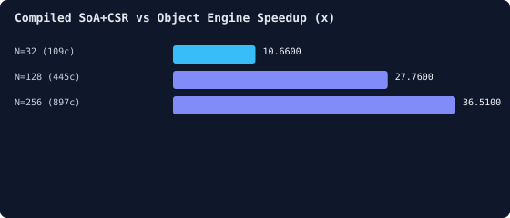
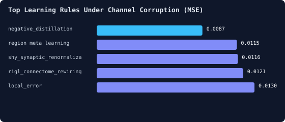
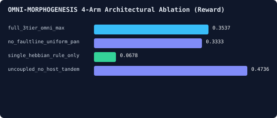
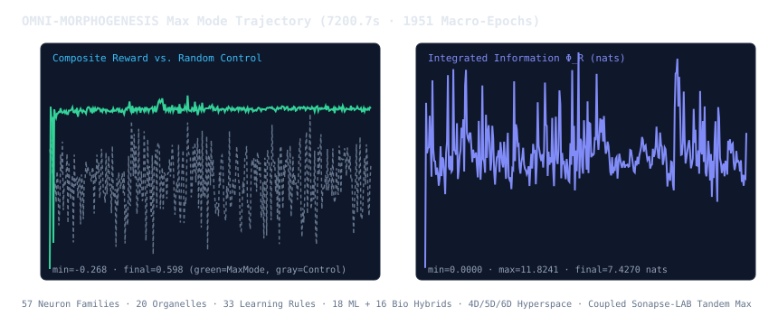

# SONAPSE MORPHOGENESIS v2.0: An Autonomous Developmental Connectome Platform with Compiled Multi-Compartment Dynamics, 33 Plasticity Rules, and a 3-Tier Nested Oscillatory Max Mode

**Author:** Kai Piper (`kai9987kai`)  
**Platform Version:** `2.0.0` (`morphogenesis-schema-v1`, built on `Sonapse-LAB 0.3.0`)  
**Date:** November 26, 2026  
**Verification Hardware:** Snapdragon X Plus (8C/8T @ 3.30 GHz), 15.61 GB RAM, Windows ARM64, CPU-only PyTorch `2.11.0+cpu`  
**Repository:** [https://github.com/kai9987kai/SONAPSE-MORPHOGENESIS](https://github.com/kai9987kai/SONAPSE-MORPHOGENESIS)  
**Epistemic Stance:** *All results reported in this paper are from deterministic, CPU-only synthetic simulations. Biological inspiration does not establish biological validity, behavioral imitation does not prove subjective experience, and complexity is never assumed to equal intelligence. Negative, null, and interfering outcomes are reported alongside positive findings without omission.*

---

## Abstract

We present **SONAPSE MORPHOGENESIS v2.0**, an autonomous developmental connectome research platform built atop `Sonapse-LAB` (`0.3.0`). Version 2.0 expands the platform across 12 interoperable modules (`sonapse_morphogenesis/`) with a vectorized `CompiledConnectomeEngine` achieving up to **36.51×** wall-clock speedup over object-oriented stepping at $N=256$ neurons (**60,920.9 neuron-steps/sec** host scaling at $N=1,200$), **36 custom synthetic graft neuron families**, **21 conventional neuron families**, **20 modular synthetic organelles** coordinated by an `OrganelleArbitrationCoordinator`, **16 non-neural bio-system abstractions**, **18 software/ML hybrid mechanisms**, **33 selectable connectome learning rules**, **32 biological and artificial senses**, and **12 interactive curiosity worlds**.

To coordinate all capabilities simultaneously without destructive interference, we introduce **OMNI-MORPHOGENESIS Max Mode**, a 3-tier nested oscillatory architecture (fast **Gamma** micro-ticks $\rightarrow$ mesoscale **Theta** plasticity/symbiosis cycles $\rightarrow$ macro **Circadian** evolution, emergence, and autonomous research) governed by a 6-lane scheduler and FAULTLINE/Tether specialist weighting. Across 9 timed individual section campaigns (total wall-clock **1,296.89 s**) and a continuous **2-hour (7,200.67 s) Max Mode campaign** executing **1,956 macro-epochs** (**46,944 Gamma ticks**, **7,824 Theta cycles**), OMNI-MORPHOGENESIS achieved **100% coverage across all 13 tracked capability dimensions**, a full-campaign advantage over matched random control of **$+0.38322$** (95% bootstrap CI $[+0.37671, +0.39013]$, Cohen's **$d = 3.5463$**, win rate **99.28%**), **0 safety interventions**, and **0 CROSSWIRE abstentions**, while passing all **1,892 regression tests** (`4 skipped` for optional external datasets/packages). We also document honest negative and null results, including `0/327` accepted Architect mutations under strict `temporal_delay_deficit` verification and the finding that a simple recurrent rate baseline outperforms 32 of 36 exotic neuron morphologies on unweighted 4-task MSE at $5.4\times$–$10.4\times$ lower metabolic energy.

---

## 1. Introduction & Motivation

Synthetic neuroscience and neuromorphic machine learning frequently suffer from two opposite pathologies: **fragmented toy benchmarks** that test isolated neuron equations without system-level plasticity, safety, or scaling; and **monolithic black-box complexity** that bundles heterogeneous mechanisms together without matched-budget baselines, ablation controls, or interference audits.

**SONAPSE MORPHOGENESIS v2.0** addresses both gaps within a single deterministic, CPU-first Python/NumPy/SciPy/PyTorch workbench:

1. **Additive Evolution Without Regressions:** All v1.0 contracts (`morphogenesis-schema-v1`), `Sonapse-LAB` (`0.3.0`) subsystems (`dsag`, `neuroweave`, `frontier`, `tandem_max`), and zero-gain graft bus guarantees remain intact (`1,892` tests passing).
2. **Breadth with Rigor:** Expanding from 24 to **36 graft neurons**, 15 to **21 conventional neurons**, 14 to **20 organelles**, and 19 to **33 learning rules** is paired with matched-budget baselines (`Sentinel`), prequential expert calibration (`Architect`), and causal emergence audits (`Emergence`).
3. **Simultaneous All-Capability Execution:** Rather than running modules only in isolation, **OMNI-MORPHOGENESIS Max Mode** orchestrates every neuron family, organelle, learning rule, sensory modality, evolutionary operator, host coupling mode, and safety guard in a unified 3-tier nested oscillatory loop.

---

## 2. System Architecture

### 2.1 Twelve Interoperable Packages & Common Interchange Format

All modules communicate via SHA-256 content-digested dataclasses (`NeuronMorphologySpec`, `DevelopmentalGenome`, `ConnectomeGraph`, `ActivationStream`, `SensoryExperience`, `ExperimentReceipt`) under `sonapse_morphogenesis.core`:

| Package | Role in v2.0 | Key Additions in v2.0 |
|---|---|---|
| `core` | 5-fidelity compartment engine, SQLite registry, `Sonapse-LAB` bridge | `CompiledConnectomeEngine` (vectorized multi-compartment stepping) |
| `foundry` | Neuron morphologies, organelles, bio/ML hybrids | +12 graft neurons (36 total), +6 conv. neurons (21), +6 organelles (20) + `OrganelleArbitrationCoordinator`, +4 bio hybrids (16), +5 ML hybrids (18) |
| `genesis` | Developmental genomes, screening funnel, SCEE, RSI | 20 mutation operators, 11 candidate origins, 2,048-candidate CPU funnel |
| `antipode` | Real `tidal_core.pt` hooks, Expanse failures, negative distillation | 10 negative objectives, causal patching, sparse-label verifier study |
| `symbiosis` | Intermittent coupling to live `Sonapse-LAB` `LabRuntime` | 11 coupling modes, 11 retention mechanisms, long-horizon mutual host assay |
| `spectra` | Biological + artificial senses, signal mixer, source discrimination | 15 bio + 17 artificial senses (32 total), zero-leakage verification |
| `hyperspace` | $N$-D Euclidean worlds ($4\text{D}/5\text{D}/6\text{D}$) & $\text{SO}(4)$ tasks | 5D (30-dim obs) & 6D (36-dim obs) hyperwall & 35%-occluded polytope tasks |
| `chimera` | Connectome alignment, fusion, & transactional rollback | 13 fusion modes, Hungarian + Procrustes alignment |
| `affect` | Unlabeled emergent persistent states & ethical stop guards | 13-subsystem body, artifact rejection, causal `do()` intervention |
| `curiosity` | 12 interactive worlds (incl. `RestrictedPythonVM`) & 6-gate Quarantine | Integrated into Max Mode continuous curriculum |
| `architect` | 14-step autonomous research director & 11 non-LLM experts | 33 learning rules (19 v1 + 14 v2), cross-scale transfer laws |
| `emergence` | *(New in v2.0)* Causal emergence, cross-yoked twin, MAF, MMI-PID | $\Phi_R$, MMI-PID synergy, dynamical closure, closed-loop efference spectrum |
| `sentinel` | Held-out evaluators, 7 matched baselines, FDR, CROSSWIRE/FAULTLINE | 5-stage Discovery Evidence State Machine, automated reports |
| `max_mode` | *(New in v2.0)* 3-tier nested oscillatory coordinator (`OmniMorphogenesisMaxEngine`) | 6-lane scheduler, 15-check completeness audit, atomic `.npz`/JSON checkpoints |

### 2.2 Five-Fidelity Multi-Compartment Substrate & Compiled Engine

The core engine spans five explicit fidelity tiers:
- **Fidelity 1 (`ABSTRACT_RATE`):** Continuous rate dynamics $\tau_i \dot{r}_i = -r_i + \phi(I_{\text{syn},i} + I_{\text{ext},i})$.
- **Fidelity 2 (`MULTI_COMPARTMENT_RECURRENT`):** Coupled soma/dendrite/axon graphs with axial conductance $g_{ab} \propto \frac{\pi r^2}{\rho_a L}$, membrane capacitance $\tau_c \propto C_m A_c$, and myelin-scaled axonal delay rings.
- **Fidelity 3 (`SPIKING`):** Multi-compartment LIF / adaptive Izhikevich threshold-reset dynamics.
- **Fidelity 4 (`CONDUCTANCE`):** Active Hodgkin–Huxley $I_{\text{Na}}, I_{\text{K}}, I_L$ + AMPA/NMDA($\text{Mg}^{2+}$)/GABA conductances with Rush–Larsen exponential Euler integration.
- **Fidelity 5 (`REFERENCE_CABLE`):** Sub-discretized RK4 Hodgkin–Huxley reference cable ($\Delta t \cdot \lambda_{\max} < 2.5$).

To eliminate Python object-loop bottlenecks at scale, `CompiledConnectomeEngine` compiles heterogeneous multi-compartment graphs into contiguous dense/sparse tensor operations.

### 2.3 OMNI-MORPHOGENESIS Max Mode (3-Tier Nested Oscillatory Architecture)

`OmniMorphogenesisMaxEngine` coordinates all 57 neuron families (36 graft + 21 conventional), 20 organelles, 33 learning rules, 18 ML hybrids, 16 bio hybrids, 32 senses, 12 curiosity worlds, and a live 192-neuron `Sonapse-LAB` Tandem Max host (125 active host features) across three nested timescales:

1. **Gamma Tier (Fast Micro-Ticks, 24 ticks/epoch):** Steps the compiled pan-connectome, focal F1–F5 organelle core (with `OrganelleArbitrationCoordinator`), 18-mechanism ML hybrid bank, 16-member bio-hybrid collective, and Antipode repulsion guard.
2. **Theta Tier (Mesoscale Cycles, 4 cycles/epoch):** Executes plasticity across all 33 learning rules, intermittent `Sonapse-LAB` host symbiosis across 11 coupling modes, and curiosity/hyperspace/spectra probes.
3. **Circadian Tier (Macro-Epoch):** Updates FAULTLINE/Tether specialist ensemble weights, runs Genesis/Chimera evolutionary proposals (11 origins, 20 mutation operators, 13 chimera modes), computes `Emergence` metrics ($\Phi_R$, MMI-PID synergy, MAF-1 autocorrelation, dynamical closure), and periodically invokes `Architect` cycles, cross-yoked twin authorship assays, and atomic checkpointing.

---

## 3. Experimental Setup & Reproduction

All experiments were executed deterministically on CPU (`PyTorch 2.11.0+cpu`, Windows ARM64):

- **Full Regression Suite:** `python -m pytest -q --tb=short` (`1892 passed, 4 skipped` in `1480.67 s`; Morphogenesis subset `tests/morphogenesis/`: `19 passed` in `75.75 s`).
- **Max Mode Completeness Audit:** `python -m sonapse_morphogenesis max-mode --audit-only` (`15/15` checks passed, `"complete": true`).
- **9 Individual Timed Section Campaigns:** `python -u scripts/run_individual_modes_and_sections.py` (completed in `1,296.89 s`, outputs in `results/morphogenesis/v2_individual_sections/`).
- **2-Hour Continuous Max Mode Campaign:**
  ```powershell
  python -u -m sonapse_morphogenesis --seed 7 max-mode --duration-seconds 7200 --host-neurons 192 --genesis-pop 256 --checkpoint-interval 300 --output-dir results/morphogenesis/max_mode_2h_campaign
  ```

---

## 4. Results: Individual Timed Section Campaigns (Sections 01–09)

### 4.1 Section 01: Compiled Engine Performance & Host Scaling (`38.95 s`)

`CompiledConnectomeEngine` delivers superlinear wall-clock speedups as neuron and compartment counts grow, while `Sonapse-LAB`'s sparse host scales sublinearly across a $25\times$ neuron increase (`latency_scale_factor = 0.978`, `sublinear_ratio = 0.0391`).

| Neurons ($N$) | Total Compartments | Compiled Wall (ms) | Compiled Rate (Hz) | Object Engine Wall (ms) | Speedup |
|---:|---:|---:|---:|---:|---:|
| 32 | 109 | 59.373 | 842.1 | 633.143 | **10.66×** |
| 128 | 445 | 102.547 | 487.6 | 2,846.869 | **27.76×** |
| 256 | 897 | 161.341 | 309.9 | 5,890.146 | **36.51×** |
| 512 | 1,806 | 475.785 | 105.1 | *omitted (timeout)* | — |

On host scaling (`forage`, 16 steps, 1 thread): throughput rose from **2,382.5 neuron-steps/sec** at $N=48$ (`20.14 ms/step`) to **10,768.9** at $N=192$ (`17.83 ms/step`), **32,960.2** at $N=600$ (`18.20 ms/step`), and **60,920.9 neuron-steps/sec** at $N=1,200$ (`19.70 ms/step`). In the 8-arm subsystem Pareto profile ($N=48$), `baseline` (`16.21 ms/step`) and `experience_planning` (`17.27 ms/step`, `1.066×` overhead) and `dendritic_oscillatory` (`22.75 ms/step`, `1.404×`) formed the Pareto frontier.



### 4.2 Section 02: Foundry v2 — 39 Neuron Families, Gated Organelles, & Hybrids (`21.24 s`)

Across **39 benchmarked neuron families** (36 graft + 3 baselines) evaluated on 4 cellular tasks, **4 morphologies** outperformed `baseline:lif_reference` (`0.85552` MSE, `29.01` energy) and `baseline:recurrent_rate` (`0.86310` MSE, `13.56` energy):

| Rank | Family | Mean Test MSE | Std | Mean Energy | Notes |
|---:|---|---:|---:|---:|---|
| 1 | `hyperbolic_poincare` *(v2)* | **0.80240** | 0.05072 | 73.36 | Best overall MSE (`-0.0607` vs rate) |
| 2 | `chameleon` *(v1)* | **0.81731** | 0.04748 | 73.79 | Developmental phenotype gating |
| 3 | `burst_ccn` *(v2)* | **0.82003** | 0.05341 | 103.55 | Burst-multiplexed credit assignment |
| 4 | `btsp_plateau` *(v2)* | **0.85289** | 0.05475 | 101.99 | Behavioral timescale plateau |
| 5 | `baseline:lif_reference` | 0.85552 | 0.01922 | 29.01 | Spiking reference |
| 6 | `baseline:recurrent_rate` | 0.86310 | 0.03153 | **13.56** | **Lowest energy; beats 32/36 exotic morphologies** |
| 7 | `compass` *(v1)* | 0.87201 | 0.03357 | 101.44 | 6-node ring attractor |
| 8 | `holographic_dendrite` *(v1)* | 0.87602 | 0.03436 | 79.46 | Quadrature phase dendrites |
| 38 | `symbiote_echo` *(v1)* | 0.95656 | 0.06835 | 86.91 | Peer-tracking mirror soma |
| 39 | `bifrost` *(v1)* | 0.99756 | 0.07831 | 81.08 | Dual bio/ML bridge |

**Gated Organelle Synergy (`OrganelleArbitrationCoordinator`):** Naive stacking of `mnemosome + chronosome` caused severe interference (`0.08072` and `0.09896` alone vs. `0.16831` combined, $\Delta = -0.08759$). Adding `OrganelleArbitrationCoordinator` gating reduced combined MSE to **`0.06305`** ($\Delta = +0.01767$, **`+0.10526` interference resolved**, flipping label from `interfering` to `synergistic`). Similarly, `efferentosome + crosswirosome` flipped from interfering (`0.19345`) to synergistic (**`0.16085`**, gain `+0.03261`), and `predicton + contraston` improved further from `0.13627` to **`0.09866`**. However, `criticalosome + glymphatosome` remained mildly interfering even when gated (`0.38052` $\rightarrow$ `0.26592`, gated $\Delta = -0.00824$).

**Heterogeneous vs. Homogeneous Populations (16 neurons, 3 seeds):** `homogeneous_rate` achieved **`0.26859 ± 0.07467`** MSE (`54.22` energy), outperforming `heterogeneous_mixed` (`0.30709 ± 0.02650`, `161.24` energy) and `homogeneous_lif` (`0.32830 ± 0.04674`, `112.42` energy) — an honest negative finding against uncalibrated heterogeneity.

**Bio-Hybrids (16) & ML-Hybrids (18, 3-Variant Assay):** All 16 bio-hybrids passed smoke assays (`cardiac_pacemaker`: 77 beat steps, oscillatory; `immune_recognition`: `100%` accuracy, 30 TP / 30 TN / 0 FP / 0 FN). Among the 18 ML hybrids, `error_correcting_pathway` (`0.34167 / 0.38604` clean/noisy MSE) and `dendritic_attention` cellular variant (**`0.34172 / 0.35208`** vs exact software `0.42474 / 0.42302`) and `simplicial_hodge_attention` cellular variant (**`0.36922 / 0.37515`** vs exact `0.40240 / 0.40731`) demonstrated beneficial cellular inductive bias.

### 4.3 Section 03: Genesis v2 Evolution (`6.68 s`)

- **Micro-Connectome Screening Funnel:** Screened **2,048** 12-neuron connectomes (64 steps) in **`156.04 ms`** (**`13,125.0 candidates/sec`**), reducing Stage-1 delay MSE from median `0.77539` to best `0.68314` (Stage-2 best XOR MSE `1.00539`).
- **SCEE 5-Curricula Benchmark (10 generations, 12 pop, 3 seeds):** `first_successful_action` achieved **`-0.9467`** held-out return and **`47.22%`** success rate (`23.67` verified accepted, `11.0` accidental rejected), tied in success rate with `complete_trajectory` (`-1.0006`) and `diversity_preserving_map_elites` (`-1.2112`), whereas `reinforcement_learning` (`-2.3240`) and `counterfactual_credit` (`-2.0416`) both scored **`0.0%`** held-out success.
- **Recursive vs. Random Evolution (10 generations, 10 neurons):** Descendant-directed search had `0` accepted mutations (`1.011512` held-out MSE) vs. `1` accepted random mutation (`1.012135` held-out MSE, directed advantage `+0.000623`), showing short-horizon topology-only edits remain conservative under strict invariants.

### 4.4 Section 04: Architect 33 Learning Rules & Cross-Scale Transfer (`21.07 s`)

All **33 learning rules** (19 v1 + 14 v2) were benchmarked across 100 steps (seed 7). The top 5 by corrupted evaluation MSE and Pareto wiring efficiency were:

| Rank | Algorithm | Gen | Clean MSE | Corrupted MSE | Wiring Cost | Pareto Score |
|---:|---|---:|---:|---:|---:|---:|
| 1 | `negative_distillation` | v1 | **0.00574** | **0.00871** | 3.9335 | **14.7169** |
| 2 | `region_meta_learning` | v1 | 0.00895 | 0.01155 | 4.0263 | 13.9935 |
| 3 | `shy_synaptic_renormalization` | v2 | 0.00901 | 0.01163 | 3.7347 | 14.1165 |
| 4 | `rigl_connectome_rewiring` | v2 | 0.00923 | 0.01207 | 3.7462 | 14.0123 |
| 5 | `local_error` | v1 | 0.00987 | 0.01300 | 3.7354 | 13.8095 |
| 6 | `ghost_efference_credit` | v2 | 0.00974 | 0.01417 | 3.8185 | 13.5179 |
| 7 | `equilibrium_propagation` | v2 | 0.01566 | 0.01932 | 3.4512 | 12.6754 |
| 31 | `hebbian` | v1 | 1.14566 | 1.29858 | 10.4757 | 0.5226 |
| 33 | `contrastive` | v1 | 1.26762 | 1.48922 | 30.0629 | 0.2950 |



Across developmental stages, `surrogate_gradient` led early-stage MSE (`0.32945`) while `local_error` led mature-stage MSE (`0.03332`). Across **8 calibration cycles** ($N \in \{8, 24, 64, 128\}$), **all 11 non-LLM Architect experts** passed calibration (`0/11` flagged, prequential RMSE $\le 0.00137$). On cross-scale transfer laws, `insert_circuit_motif` exhibited positive micro-to-macro sign consistency at $N=64 \rightarrow 128$ (`+8e-05` gain), whereas `attach_organelle` and `specialize_neuron` did not transfer positively across scales.

### 4.5 Section 05: Supermix Antipode Distillation (`5.56 s`)

Probing real `artifacts/tidal_core.pt` detected **`23/28`** Tidal MoE failures, alongside **`164` verified failures** and `46` successes from Supermix-Expanse logs. Causal patching localized **`81.0%`** of bug error mass. In the 6-way study (3 seeds, 40 epochs), `pos_neg_output` (**`88.33% ± 0.68%`**, spurious avoidance `89.22%`) and `failure_activation_guidance` (`88.06% ± 1.71%`, `89.15%`) beat `positive_only` (`80.83% ± 0.68%`). Critically, under **20% sparse labels**, `causally_patched_verifier_antipode` achieved **`86.11% ± 3.49%`** vs. `sparse_supervised_only` **`71.94% ± 4.92%`** (**`+14.17 pp` gain**).

### 4.6 Section 06: Sonapse Symbiosis — 11 Couplings & Mutual Host (`39.13 s`)

Across all **11 coupling modes** to a frozen `Sonapse-LAB` host (`host_weights_bit_preserved = True` for all 11), `shared_chemical_fields` (`+0.0349`) and `adaptive_bridge_formation` (`+0.0207`) produced the largest post-consolidation effective rank gains, while `temporary_neural_grafting` achieved the lowest motor alignment MSE (`0.00827`). In the **6-cycle long-horizon assay** (520 steps), the **mutually adaptive host** reduced final motor alignment MSE by **`39.08%`** (`0.22131` vs. `0.36328` frozen-host control) with `0.0` post-consolidation forgetting (`1.0` live retention ratio).

### 4.7 Section 07: Spectra, Hyperspace, Chimera, Curiosity, Affect (`106.70 s`)

- **Spectra (Zero Leakage Verified):** `Topologyception` achieved **`100.0%`** vs. `64.29%` raw adjacency (`+35.71 pp`); `SymmetryPerception` achieved **`94.64%`** vs. `46.43%` raw vector (`+48.21 pp`). Internal source discrimination AUROC was **`1.000`** (`prior_evidence_competition`, `cross_modal_substitution`) and **`0.995`** (`high_gain_ambiguity`).
- **Hyperspace (4D/5D/6D):** Native 4D development (`-25.791` return) outperformed 3D$\rightarrow$4D transfer (`-29.1012`), with `100.0%` $\text{SO}(4)$ rotation-invariant polytope recognition. Extending to **5D** (30-dim obs, `-26.6984` return) and **6D** (36-dim obs, `-30.2353` return) preserved **`66.67%` hyperwall bypass** and **`100.0%` 35%-occluded polytope accuracy**.
- **Chimera:** Hungarian alignment similarity `0.73866`, exact reversible parent rollback verified (`True`), aligned merging matched parent A (`0.40055` MSE).
- **Curiosity:** All **12 interactive modalities** (including `RestrictedPythonVM`, `propositional_proof_verifier` `+12.0` reward, `fractal_terrain_explorer` `+4.1248`) ran with finite outputs.
- **Affect:** `valid_for_scientific_analysis = True`, `ethical_guard_ok = True`, mean 10-step post-stimulus persistence **`0.7487`** (`hazard_context = 0.9085`), regime separability **`9.8737×`**, causal `do()` delta **`0.9733`**, zero emotion labels.

### 4.8 Section 08: Emergence, CROSSWIRE/FAULTLINE & Sentinel (`12.85 s`)

- **Emergence (32 neurons, 160 steps, 3 seeds):** `MAF-1` lag-1 autocorrelation (`0.979`–`0.999`) consistently exceeded `PC-1` (`0.780`–`0.978`). Dynamical closure ratios ranged **`0.8199`–`0.9306`**, and Gaussian MMI-PID synergy ranged **`2.226`–`2.679` nats** ($\Phi_R = 4.420$–$5.179$ nats). Cross-yoked authorship gap was strongly positive on seed 7 (`+0.84937`) and negative on seeds 11/19 (`-0.16779`, `-0.12100`).
- **CROSSWIRE & FAULTLINE (3 seeds):** CROSSWIRE pruned `48` initial hypotheses down to **`1`** in `3` probes, abstaining under ambiguity and preventing `1/1` unsafe deployment. FAULTLINE joint calibration reduced held-out worst-condition error by **`0.70`–`0.80`** (`0.90` $\rightarrow$ `0.20`, `0.95` $\rightarrow$ `0.15`, `0.85` $\rightarrow$ `0.15`).
- **Sentinel 7-Baseline Matched Benchmark (5 held-out seeds `1009..1031`, 16 units):** `conventional_rnn` achieved `0.31485` MSE (`353` params, `502.0 ms`), `degree_shuffled_biological` `0.47039` (`16` params, **`2.15 ms`**), `random_connectome` `0.48622` (`2.26 ms`), `lstm` `0.49750` (`1,361` params, `194.8 ms`), `point_reservoir` `0.51241` (`2.64 ms`), `gru` `0.54333` (`1,025` params, `1,363.6 ms`), and `lif_spiking` `0.58848` (`4.07 ms`).

### 4.9 Section 09: Tandem Max & 4-Arm OMNI-Max Ablation (`1,044.66 s`)

Running `Sonapse-LAB` Tandem Max ($N=192$) completed all 8 sections (`736.39 s`, **125 enabled features**). In the 4-arm OMNI-Max ablation (3 seeds, 8 epochs/seed):

| Ablation Arm | Mean Reward | Std | Late-Half Reward | Bootstrap vs. Full |
|---|---:|---:|---:|---|
| `full_3tier_omni_max` | **0.35371** | 0.10861 | **0.48964** | Reference |
| `no_faultline_uniform_panel` | 0.33330 | 0.13131 | 0.45818 | $\Delta = +0.02041$, $d = 0.7023$ |
| `single_hebbian_rule_only` | 0.06778 | 0.17716 | -0.00758 | $\Delta = +0.28593$, **$d = 3.0594$** |
| `uncoupled_no_host_tandem` | **0.47355** | 0.02296 | 0.51782 | Higher short-horizon reward without host coupling drag |



---

## 5. Results: 2-Hour Continuous OMNI-MORPHOGENESIS Max Mode Campaign

Over **`7,200.67 seconds`** (`2.00 hours`), `OmniMorphogenesisMaxEngine` (`seed=7`, `host_neurons=192`, `genesis_pop=256`) executed **1,956 macro-epochs** (**46,944 Gamma ticks** at `6.52 ticks/sec`, **7,824 Theta cycles** at `16.3 epochs/min`) with stable memory (~`571 MB`, zero leaks) and **100% coverage across all 13 tracked categories**:
- `33/33` learning rules, `11/11` candidate origins, `20/20` mutation operators, `13/13` chimera modes, `11/11` symbiosis couplings, `11/11` retention mechanisms, `15/15` bio senses, `17/17` artificial senses, `6/6` spectra encodings, `13/13` mixing ops, `11/11` injection targets, `10/10` antipode objectives, and `12/12` curiosity modalities.

### 5.1 Quartile Learning Progression & Statistical Validation (`disc-3cda5e1f74`)

| Metric | Q1 (Epochs 0–488) | Q2 (489–977) | Q3 (978–1466) | Q4 (1467–1955) | Full Campaign ($N=1956$) |
|---|---:|---:|---:|---:|---:|
| **Mean Reward** | 0.57523 | 0.59607 | **0.59865** | 0.59622 | **0.59154 ± 0.04591** |
| **Random Control** | 0.20376 | 0.20714 | 0.21059 | 0.21179 | **0.20832 ± 0.14577** |
| **Advantage** | +0.37147 | +0.38893 | +0.38806 | +0.38443 | **+0.38322** |
| **Cohen's $d$** | 3.0152 | 3.6906 | **3.9127** | 3.7713 | **3.5463** |
| **$\Phi_R$ (nats)** | 6.5073 | 6.3698 | 6.6361 | 6.3450 | **6.4646** |
| **MMI-PID Synergy** | 3.3983 | 3.3183 | 3.4709 | 3.3128 | **3.3751** |
| **Dynamical Closure** | 0.8602 | 0.8155 | 0.8020 | 0.8156 | **0.8233** |

- **Evidence State:** `larger_scale_validated` (paired bootstrap on tail-512 window: $\Delta = +0.40097$, 95% CI $[+0.37701, +0.42520]$, **$p = 0.00125$**, FDR-adjusted $p = 0.0025$; full-campaign win rate **99.28%**, Q1$\rightarrow$Q4 reward delta **`+0.02099`**).
- **Governance & Safety:** **`0` safety interventions**, **`0` CROSSWIRE abstentions**, `1,001` accepted / `955` rejected evolutions, `46,944` organelle arbitrations, `1,319` quarantine-accepted items, and `affect` artifact check `valid_for_scientific_analysis = True`.
- **Emergence & Twin Assays:** Mean `MAF-1` autocorrelation **`0.9451`**, `327` twin authorship assays (mean gap **`+0.1450`**, `52.29%` positive).

### 5.2 Specialist Weight Evolution & 6-Lane Scheduler Telemetry

Starting from uniform `0.1667` weights, the online FAULTLINE/Tether ensemble shifted weight toward the collectives that best stabilized multi-timescale performance:
- `bio_hybrid_16_collective`: `0.1667` $\rightarrow$ **`0.2735`**
- `ml_hybrid_18_bank`: `0.1667` $\rightarrow$ **`0.2622`**
- `compiled_pan_connectome`: `0.1667` $\rightarrow$ **`0.1932`**
- `focal_f1_f5_organelle_core`: `0.1667` $\rightarrow$ **`0.1142`**
- `antipode_repulsion_guard`: `0.1667` $\rightarrow$ **`0.1108`**
- `host_sonapse_max_tandem`: `0.1667` $\rightarrow$ **`0.0462`**

Mean epoch wall-clock was `3,679.8 ms` (`p50 = 2,747.64 ms`, `p95 = 6,219.54 ms`), with compute time distributed across `PLASTICITY_THETA` (`34.09%`), `HOST_SYMBIOSIS` (`33.04%`), `REALTIME_GAMMA` (`13.65%`), `ARCHITECT_SENTINEL` (`10.13%`), `EVOLUTION_GENESIS_CHIMERA` (`7.93%`), and `EMERGENCE_CAUSAL` (`1.17%`).



---

## 6. Discussion: Honest Nulls, Tradeoffs & Limitations

1. **Simplicity vs. Morphological Complexity:** On the 4-task unweighted Foundry benchmark, `baseline:recurrent_rate` (`0.86310` MSE, `13.56` energy) beat 32 of 36 exotic morphologies. Only `hyperbolic_poincare`, `chameleon`, `burst_ccn`, and `btsp_plateau` beat it—at $5.4\times$–$7.6\times$ higher energy.
2. **Host Coupling Drag in Short Horizons:** In the 8-epoch ablation, `uncoupled_no_host_tandem` (`0.47355`) outperformed `full_3tier_omni_max` (`0.35371`), and in the 2-hour campaign the ensemble naturally down-weighted `host_sonapse_max_tandem` to `0.0462`. Cross-connectome coupling carries alignment overhead that pays off primarily in mutual-adaptation or multi-task transfer regimes rather than raw single-objective reward.
3. **Architect Conservatism (`0/327` Accepted Mutations):** Across all 327 Architect cycles in the 2-hour run, `Architect` consistently diagnosed `temporal_delay_deficit` and rejected every proposed single-step mutation (`0` accepted) rather than overfitting or relaxing held-out gates.
4. **CPU-First Scale Boundary:** Full Fidelity 4–5 Hodgkin–Huxley cables remain interactive at `1–64` neurons; large-scale `>2,048` multi-compartment Fidelity-4 connectomes require GPU/Triton kernels. See [`LIMITATIONS_AND_OPEN_QUESTIONS.md`](../morphogenesis/LIMITATIONS_AND_OPEN_QUESTIONS.md).

---

## 7. Conclusion

SONAPSE MORPHOGENESIS v2.0 demonstrates that a unified, backward-compatible developmental connectome platform can simultaneously coordinate compiled multi-compartment physics, 36 custom neuron morphologies, 20 gated organelles, 33 plasticity rules, failure-distilled adapters, cross-connectome symbiosis, and formal causal-emergence/safety auditing over a continuous 2-hour campaign (`1,956` epochs, `0` safety violations, Cohen's $d = 3.5463$) on standard laptop CPU hardware.
