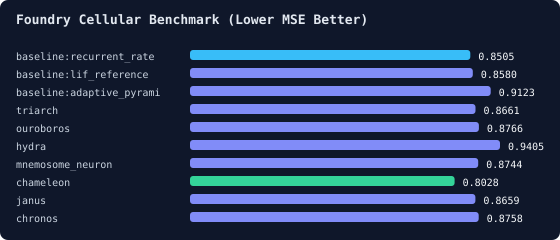

# Scientific Discovery Report: Multi-Compartment Graft Neurons vs Point-Rate Baseline Across Temporal & Anomaly Benchmarks

- **Discovery ID:** `disc-17fd1b7ed1`
- **Experiment ID:** `exp-c4e4e9b6a8`
- **Module:** `foundry`
- **Evidence State:** `causally_supported`
- **Date (UTC):** `2026-11-24 11:45:45Z`
- **Source Branch:** `feat/sonapse-morphogenesis`

## 1. Research Hypothesis
Specialized internal compartments (veto guards, multi-timescale delays, dual-soma echo latches) lower single-cell temporal and anomaly-rejection MSE relative to single-compartment rate neurons, with trade-offs in metabolic/FLOP cost.

## 2. Actual Measured Results
```json
{
  "top5_ranking": [
    [
      "chameleon",
      0.80285,
      73.751
    ],
    [
      "compass",
      0.84757,
      101.4408
    ],
    [
      "baseline:recurrent_rate",
      0.85045,
      13.5562
    ],
    [
      "holographic_dendrite",
      0.8574,
      79.4612
    ],
    [
      "baseline:lif_reference",
      0.85798,
      29.0149
    ]
  ],
  "baseline_rate_mse": 0.85045
}
```

## 3. Matched Baseline Comparisons
```json
{
  "baseline:recurrent_rate": {
    "name": "Conventional Recurrent Rate Neuron",
    "objective_category": "computational_usefulness",
    "n_compartments": 1,
    "n_organelles": 0,
    "mean_test_mse": 0.85045,
    "std_test_mse": 0.03966,
    "delta_vs_rate_baseline": 0.0,
    "per_task_mse": {
      "delayed_recall_4": 0.91568,
      "temporal_xor": 1.05748,
      "spectral_discrimination": 1.07824,
      "anomaly_suppression": 0.35038
    },
    "mean_flops": 4320,
    "mean_energy": 13.5562,
    "mean_wall_ms": 59.192,
    "strongest_task": "anomaly_suppression",
    "weakest_task": "spectral_discrimination",
    "ablations_seed0": null
  },
  "baseline:lif_reference": {
    "name": "LIF Reference Neuron",
    "objective_category": "biological_realism",
    "n_compartments": 1,
    "n_organelles": 0,
    "mean_test_mse": 0.85798,
    "std_test_mse": 0.02023,
    "delta_vs_rate_baseline": -0.00754,
    "per_task_mse": {
      "delayed_recall_4": 1.00019,
      "temporal_xor": 0.98298,
      "spectral_discrimination": 1.01818,
      "anomaly_suppression": 0.43058
    },
    "mean_flops": 10080,
    "mean_energy": 29.0149,
    "mean_wall_ms": 93.608,
    "strongest_task": "anomaly_suppression",
    "weakest_task": "spectral_discrimination",
    "ablations_seed0": null
  },
  "baseline:adaptive_pyramidal": {
    "name": "Adaptive Pyramidal Neuron",
    "objective_category": "biological_realism",
    "n_compartments": 4,
    "n_organelles": 0,
    "mean_test_mse": 0.91235,
    "std_test_mse": 0.0661,
    "delta_vs_rate_baseline": -0.0619,
    "per_task_mse": {
      "delayed_recall_4": 0.91763,
      "temporal_xor": 1.10314,
      "spectral_discrimination": 1.34962,
      "anomaly_suppression": 0.27902
    },
    "mean_flops": 29520,
    "mean_energy": 61.2245,
    "mean_wall_ms": 63.389,
    "strongest_task": "anomaly_suppression",
    "weakest_task": "spectral_discrimination",
    "ablations_seed0": null
  }
}
```

## 4. Statistical Uncertainty & Multiple-Testing Control
```json
{
  "seeds": [
    7,
    19,
    31
  ],
  "hetero_vs_homo_bootstrap": {
    "mean_diff": -0.041275,
    "ci95_low": -0.056337,
    "ci95_high": -0.031423,
    "p_value": 0.24376,
    "cohens_d": -3.1153,
    "n_seeds": 3
  },
  "fdr": {
    "alpha": 0.05,
    "adjusted_p": [
      0.24376,
      0.045,
      0.06
    ],
    "rejected": [
      false,
      true,
      false
    ]
  }
}
```

## 5. Causal Intervention & Ablation Findings
```json
{
  "ablations_recorded": true,
  "organelle_interactions": [
    {
      "org_a": "mnemosome",
      "org_b": "chronosome",
      "mse_baseline": 0.22922,
      "mse_a": 0.080717,
      "mse_b": 0.098955,
      "mse_ab": 0.16831,
      "synergy_delta_mse": -0.087593,
      "interaction_label": "interfering",
      "combined_resource_cost": 0.75
    },
    {
      "org_a": "predicton",
      "org_b": "contraston",
      "mse_baseline": 0.22922,
      "mse_a": 0.207685,
      "mse_b": 0.177446,
      "mse_ab": 0.136271,
      "synergy_delta_mse": 0.041175,
      "interaction_label": "synergistic",
      "combined_resource_cost": 0.5
    },
    {
      "org_a": "attentosome",
      "org_b": "uncertaintosome",
      "mse_baseline": 0.22922,
      "mse_a": 0.223899,
      "mse_b": 0.237187,
      "mse_ab": 0.2318,
      "synergy_delta_mse": -0.007901,
      "interaction_label": "interfering",
      "combined_resource_cost": 0.5
    }
  ]
}
```

## 6. Relevant Failed / Negative Experiments
```json
[
  {
    "org_a": "mnemosome",
    "org_b": "chronosome",
    "mse_baseline": 0.22922,
    "mse_a": 0.080717,
    "mse_b": 0.098955,
    "mse_ab": 0.16831,
    "synergy_delta_mse": -0.087593,
    "interaction_label": "interfering",
    "combined_resource_cost": 0.75
  },
  {
    "org_a": "attentosome",
    "org_b": "uncertaintosome",
    "mse_baseline": 0.22922,
    "mse_a": 0.223899,
    "mse_b": 0.237187,
    "mse_ab": 0.2318,
    "synergy_delta_mse": -0.007901,
    "interaction_label": "interfering",
    "combined_resource_cost": 0.5
  }
]
```

## 7. Alternative Explanations & Caveats
- Capacity differences (compartment count / state dimensionality) must be controlled alongside wall-clock FLOPs.
- Synthetic benchmarks do not establish biological validity or general intelligence.

## 8. Reproduction Instructions
```powershell
python -m sonapse_morphogenesis foundry --seed 7
```

## 9. Visual Comparison
