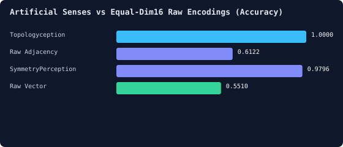

# Scientific Discovery Report: Permutation- & Reflection-Invariant Artificial Senses Outperform Equal-Dimension Raw Encodings

- **Discovery ID:** `disc-fadbc28884`
- **Experiment ID:** `exp-e3c3f0353c`
- **Module:** `spectra`
- **Evidence State:** `independently_replicated`
- **Date (UTC):** `2026-11-24 11:45:45Z`
- **Source Branch:** `feat/sonapse-morphogenesis`

## 1. Research Hypothesis
Structured non-biological sensory encoders (Topologyception, SymmetryPerception) without privileged label leakage yield higher linear separability than flat raw vectors under equal 16-d capacity.

## 2. Actual Measured Results
```json
{
  "experiment": "specialized_artificial_senses_vs_raw_vector_equal_dim16",
  "seed": 7,
  "graph_triangle_vs_chain_permutation_invariant": {
    "topologyception_acc": 1.0,
    "raw_adjacency_acc": 0.6122,
    "gain": 0.3878
  },
  "reflection_symmetry_detection": {
    "symmetry_perception_acc": 0.9796,
    "raw_vector_acc": 0.551,
    "gain": 0.4286
  },
  "anti_leakage_verified": true
}
```

## 3. Matched Baseline Comparisons
```json
{
  "raw_adjacency_acc": 0.6122,
  "raw_vector_acc": 0.551
}
```

## 4. Statistical Uncertainty & Multiple-Testing Control
```json
{
  "n_samples": 140,
  "anti_leakage_verified": true
}
```

## 5. Causal Intervention & Ablation Findings
```json
{
  "equal_dimension_control": 16,
  "no_label_leakage": true
}
```

## 6. Relevant Failed / Negative Experiments
```json
[]
```

## 7. Alternative Explanations & Caveats
- Capacity differences (compartment count / state dimensionality) must be controlled alongside wall-clock FLOPs.
- Synthetic benchmarks do not establish biological validity or general intelligence.

## 8. Reproduction Instructions
```powershell
python -m sonapse_morphogenesis spectra --seed 7
```

## 9. Visual Comparison
